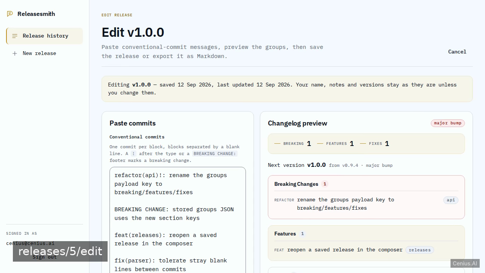
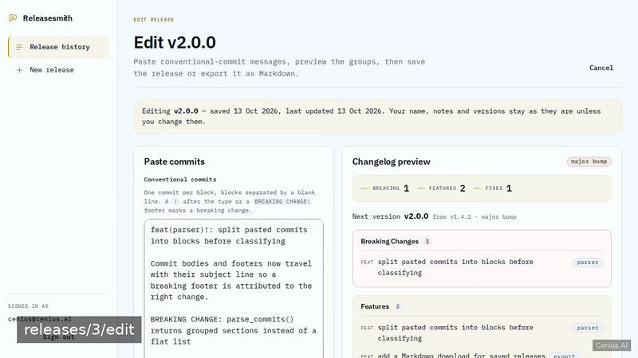
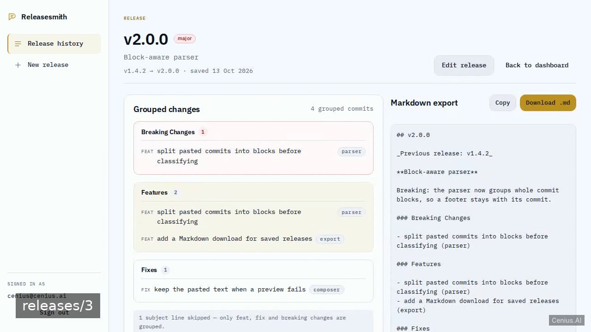
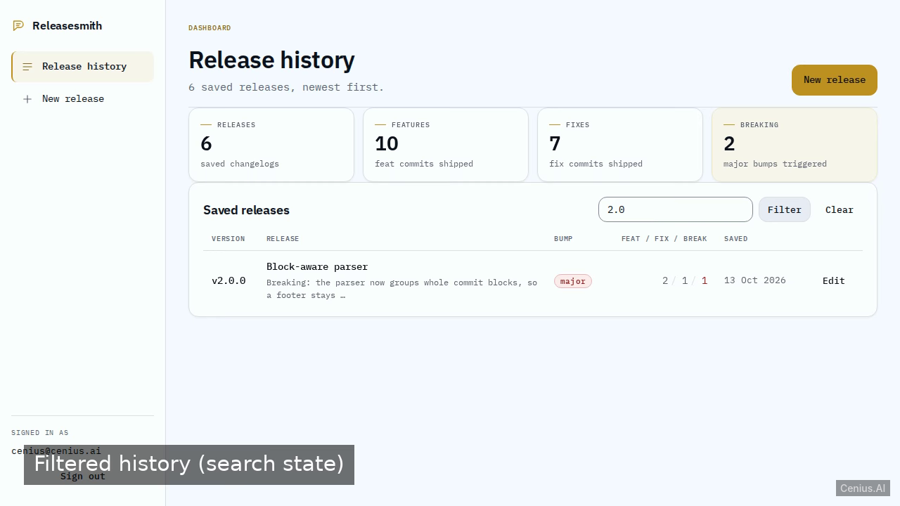

# Releasesmith Changelog Generator — production-ready FastAPI web application starter

This repository contains the complete source for **Releasesmith Changelog Generator**, an open-source web application built with FastAPI. Releasesmith is a self-hosted web app for maintainers who ship often: sign in, paste a block of conventional-commit lines, and get an instantly grouped, release-ready changelog (Breaking changes / Features / Fixes) wi…. Everything Releasesmith Changelog Generator needs to run is here — code, seed data, install scripts. Apache-2.0-licensed — use Releasesmith Changelog Generator commercially, self-host it, or [remix Releasesmith Changelog Generator on cenius.ai](https://cenius.ai/marketplace/p/releasesmith-changelog-generator?ref=gh&utm_campaign=releasesmith-changelog-generator-fastapi) to make it yours.


[](LICENSE)  [](https://cenius.ai)

[](https://cenius.ai/marketplace/p/releasesmith-changelog-generator?ref=gh&utm_campaign=releasesmith-changelog-generator-fastapi)

> **▶ [Open & edit in cenius.ai](https://cenius.ai/marketplace/p/releasesmith-changelog-generator?ref=gh&utm_campaign=releasesmith-changelog-generator-fastapi)** — one click to an editable workspace: describe changes in plain English, get an instant preview, one-click deploy and host. Modifications made on the platform come with full rebrand & relicense rights.

_Local clone? See [Quick start](#quick-start) below. cenius.ai is the zero-setup path._

## Demo





▶ **[Watch the full demo video](https://cenius.ai/marketplace/p/releasesmith-changelog-generator?ref=gh&utm_campaign=releasesmith-changelog-generator-fastapi)** — the complete walkthrough, playing on the project's cenius.ai page · [MP4 file](.github/media/demo.mp4)

## Screenshots

  

## Architecture

No external services required: the entire web application runs from this FastAPI repo (67 files). Top-level layout: `app/`, `tests/`. Starting up is just `./install.sh`: it installs what is needed and pre-fills the database so you have data to work with straight away. Installation walkthrough: [`INSTALL.md`](INSTALL.md).

## Features

- Email/password accounts with sessions
- Paste commits, parse into Breaking / Features / Fixes
- Semantic version bump suggestion
- Save releases and browse release history
- Edit and delete a saved release
- Markdown export
- Seeded demo workspace

## Quick start

```bash
./install.sh   # installs dependencies + seeds demo data
```

See [`INSTALL.md`](INSTALL.md) for full setup and usage instructions.

## Usage guide

### Overview

This is **Releasesmith Changelog Generator** — an HTTP API + web UI. This document covers the surface area you can use, with copy-pasteable examples for each entry point. For setup, see `INSTALL.md`.

### Quickstart

After completing the install steps in `INSTALL.md`:

```bash
uvicorn app.main:app --reload    # start the server
## in another terminal:
curl http://localhost:8000/
```

### Endpoints

Every endpoint below was extracted from the source by the route scanner (Next.js / FastAPI / Flask / Django / Express).

_Full guide: [`USAGE.md`](USAGE.md)_

## FAQ

### Can I deploy Releasesmith Changelog Generator on my own infrastructure?

It runs entirely on your own machine. Clone, run `./install.sh`, and follow [`INSTALL.md`](INSTALL.md) — the whole stack is in this repo, no external dependencies required.

### Is it OK to ship Releasesmith Changelog Generator as part of a product?

Confirmed free for commercial use — MIT terms let you incorporate, resell, or ship it in any product. [LICENSE](LICENSE).

### Can non-developers customise Releasesmith Changelog Generator?

Describe what you want changed on [cenius.ai](https://cenius.ai/marketplace/p/releasesmith-changelog-generator?ref=gh&utm_campaign=releasesmith-changelog-generator-fastapi) — no code editing needed; the platform produces a fresh build you can download and deploy.

### What is Releasesmith Changelog Generator built with?

FastAPI end-to-end. Every file you need to run the app is here in this repository — code, configuration, seed data. Highlights include email/password accounts with sessions.

### How do I make Releasesmith Changelog Generator my own brand?

White-labeling is supported: fork the MIT-licensed source and rebrand it yourself, or use [cenius.ai](https://cenius.ai/marketplace/p/releasesmith-changelog-generator?ref=gh&utm_campaign=releasesmith-changelog-generator-fastapi) to make changes in a guided workspace — platform modifications come with full rebrand rights.

## License & rebranding

Released under the [Apache License 2.0](LICENSE) (© 2026 Cenius AI) — free for personal and commercial use. The Cenius name/logo are trademarks (see NOTICE).

**Need a customized version?** [Remix this app on cenius.ai](https://cenius.ai/marketplace/p/releasesmith-changelog-generator?ref=gh&utm_campaign=releasesmith-changelog-generator-fastapi) — modifications made on the platform come with **full rebrand & relicense rights** over your derivative.

## Built with cenius.ai

This entire application — code, design, seeded demo data — was generated on **[cenius.ai](https://cenius.ai)** from a plain-English description.

- 🚀 [Build your own app on cenius.ai](https://cenius.ai)
- 🎛️ [Remix Releasesmith Changelog Generator on the marketplace](https://cenius.ai/marketplace/p/releasesmith-changelog-generator?ref=gh&utm_campaign=releasesmith-changelog-generator-fastapi) — open it in a workspace, prompt for changes, and ship your own version.

More open-source apps: [the Cenius-ai catalog](https://github.com/Cenius-ai) · [showcase index](https://github.com/Cenius-ai/showcase)
